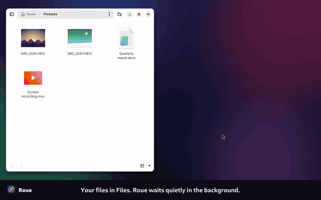

<div align="center">


# Roue

**Drop a file. Get the file you wanted.**

A tiny drag-and-drop file converter for the Linux desktop.<br>
Press a key, drop a file on a tile, done. No dialogs, no editors, no uploads.

[](https://github.com/guilyx/roue/actions/workflows/ci.yml)
[](LICENSE)
[](https://www.python.org)
[](https://gnome.pages.gitlab.gnome.org/libadwaita/)

[Website](https://guilyx.github.io/roue/) · [Docs](https://guilyx.github.io/roue/docs/) · [Install](#install) · [Presets](#presets) · [Contributing](CONTRIBUTING.md)



▶️ **[Watch the 50-second demo](https://guilyx.github.io/roue/#demo)** (photo to JPG, video under 10 MB, Shift-drag, terminal)

</div>

## What it does

Linux has excellent conversion tools (FFmpeg, libvips, Ghostscript, Pandoc,
LibreOffice) and almost no fast, friendly front door to them. Roue is that door.

- 📱 **iPhone photo won't open?** Drop the `.HEIC` on **JPG**.
- 💬 **Screen recording too big for chat?** Drop it on **Under 10 MB**.
- 🎞️ **Need a GIF for a README?** Drop the video on **GIF**.
- 📄 **Someone sent a `.docx`?** Drop it on **PDF**.
- 🕵️ **Posting a photo?** **Remove metadata** strips the GPS location first.

Results land next to the original (`photo.jpg`, `clip (10MB).mp4`) and
**never overwrite anything**.

## Three ways in

| | How | Best for |
|---|---|---|
| 🎯 **Drop panel** | Press **Super+Shift+D**, drop files on a tile. On X11, just **hold Shift while dragging** any file. | Everyday use |
| 🖱️ **Files menu** | Right-click files in Files (Nautilus) → **Convert to…** | Batches, Wayland |
| ⌨️ **Command line** | `roue jpg IMG_0042.heic` | Scripts, power users |

All three share the same engine, presets and settings.

> **Wayland vs X11** — Wayland keeps other apps' drags private (on purpose), so
> Shift-drag only works on X11. On Wayland, use the hotkey, the Files menu, or
> copy files (Ctrl+C), open the panel and click a tile.

## Install

### Ubuntu / Debian (24.04+)

Download `roue_0.1.0_all.deb` from the [latest release](https://github.com/guilyx/roue/releases/latest), then:

```bash
sudo apt install ./roue_0.1.0_all.deb
roue setup          # sets the Super+Shift+D hotkey
```

The package adds the app launcher and the Files menu (restart Files once: `nautilus -q`).

### Any distribution, from source

Install the tools with your package manager (Ubuntu names shown), then Roue with [pipx](https://pipx.pypa.io):

```bash
sudo apt install ffmpeg libvips-tools ghostscript python3-gi gir1.2-gtk-4.0 \
  gir1.2-adw-1 python3-nautilus libheif-plugin-libde265 pipx
pipx install --system-site-packages git+https://github.com/guilyx/roue
roue setup          # launcher, Files menu, hotkey
```

Optional: `pandoc` (Markdown), `libreoffice-writer` (office documents to PDF),
`python3-xlib` (Shift-drag on X11). Run **`roue doctor`** to see what's missing.

### For contributors

```bash
git clone https://github.com/guilyx/roue && cd roue
make dev && make test
```

See [CONTRIBUTING.md](CONTRIBUTING.md).

## Command line

```bash
roue jpg IMG_0042.heic             # shorthand for: roue convert jpg IMG_0042.heic
roue gif demo.mov                  # → demo.gif
roue share-10mb screen-recording.mp4
roue webp ~/Pictures/export/       # whole folder, converted in parallel
roue pdf report.docx -o ~/Desktop  # choose where results go

roue list                          # all presets
roue list --for clip.mov           # presets that fit this file
roue info clip.mov                 # type, length, codecs, matching presets
roue doctor                        # which tools are installed
roue undo                          # move the last results to the trash
```

`--json` gives machine-readable output. Exit codes: `0` ok, `1` a conversion failed, `2` usage error.

## Presets

27 built-in presets. Add your own as small YAML files, see the [preset guide](https://guilyx.github.io/roue/docs/custom-presets.html).

| Group | Presets |
|---|---|
| 🟢 **Images** | `jpg` · `png` · `webp` · `avif` · `resize-half` · `resize-1080` · `resize-double` · `compress-image` · `strip-metadata` |
| 🔴 **Video** | `mp4` · `gif` · `webm` · `share-10mb` · `share-25mb` · `compress-video` · `mute` |
| 🟣 **Audio** | `mp3` · `opus` · `wav` · `flac` · `normalize` (audio presets also pull the sound out of videos) |
| 🔵 **Documents** | `pdf` (Word, Excel, PowerPoint, OpenDocument, Markdown) · `docx` · `html` · `compress-pdf` · `pdf-to-png` · `pdf-to-text` |

A custom preset looks like this (`~/.config/roue/presets/thumbnail.yaml`):

```yaml
id: thumbnail
name: Thumbnail
group: image
accepts: ["image/*"]
output_ext: webp
suffix: " (thumb)"
backend: image
params: { width: 320, quality: 80 }
```

## Privacy

🔒 **100% local.** Files never leave your computer. No uploads, no accounts, no
telemetry. Roue works with Wi-Fi off.

## How it's built

Python 3.12, GTK 4 and libadwaita for the panel, and a GTK-free engine that
drives FFmpeg, libvips (or ImageMagick), Ghostscript, Pandoc and LibreOffice.
One engine, three front doors. Details in the [architecture docs](https://guilyx.github.io/roue/docs/architecture.html).

## Contributing

Bug reports, presets and pull requests are welcome. Start with
[CONTRIBUTING.md](CONTRIBUTING.md) and the [roadmap](ROADMAP.md). Please follow
the [Code of Conduct](CODE_OF_CONDUCT.md). Security issues: see [SECURITY.md](SECURITY.md).

## License

[GPL-3.0-or-later](LICENSE). Roue calls external programs; each keeps its own license.
