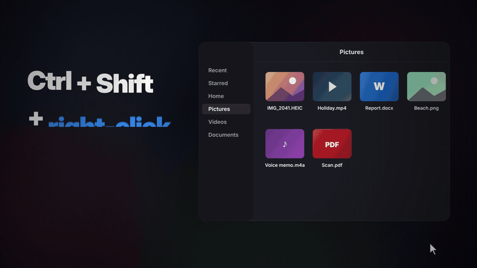
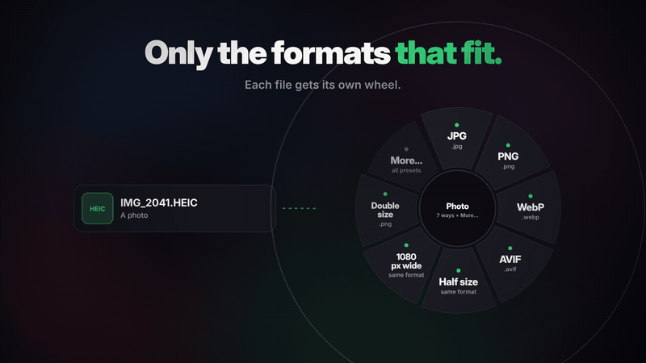

<div align="center">


# Roue

### Drop a file. Get the file you wanted.

**Ctrl+Shift+right-click any file in Files, pick a format, done.**<br>
A free, offline file converter for the Linux desktop: photos, videos, audio and documents.

[](https://github.com/guilyx/roue/releases/latest)
[](https://github.com/guilyx/roue/actions/workflows/ci.yml)
[](#install)
[](LICENSE)



```bash
wget -qO- https://guilyx.github.io/roue/install.sh | sh
```

<sub>Ubuntu 22.04+ and Debian 12+ · updates through Software Updater · [other distributions](#install)</sub>

[Website](https://guilyx.github.io/roue/) · [Watch a 50-second live demo](https://guilyx.github.io/roue/#demo) · [Docs](https://guilyx.github.io/roue/docs/) · [Presets](#presets)

</div>

## Why Roue?

Linux has excellent conversion tools (FFmpeg, libvips, Ghostscript, Pandoc,
LibreOffice) and almost no fast, friendly way to use them. Roue is that way in.

| You have… | Pick |
|---|---|
| 📱 An iPhone photo (`.HEIC`) that won't open anywhere | **JPG** |
| 💬 A screen recording too big for chat | **Under 10 MB** |
| 🎞️ A clip you want as a GIF for a README | **GIF** |
| 📄 A `.docx` someone wants as a PDF | **PDF** |
| 🎙️ A voice memo that won't play in the car | **MP3** |
| 🕵️ A photo with your GPS location in it | **Remove metadata** |

The result lands **next to the original** (`photo.jpg`, `clip (10MB).mp4`) and
**never overwrites anything**. Changed your mind? `roue undo` moves it to the trash.

## How it works

1. In Files, **Ctrl+Shift+right-click** a file. Or select several and press
   **Super+Shift+D** (Super is the Windows key).
2. The wheel opens **at the pointer**, showing only the formats those files can become.
3. **Click a slice.** A notification tells you when it's done.

<div align="center">

</div>

Prefer menus? Right-click → **Convert with Roue…** opens the same wheel.
Prefer the terminal? `roue jpg IMG_0042.heic`.

## What you get

- 🔒 **100% local.** No uploads, no accounts, no telemetry. Works with Wi-Fi off.
- 🎯 **Only what fits.** A photo gets photo formats, a video gets video ones. No dead ends.
- 📦 **27 presets** for images, video, audio and documents. Add your own in a few lines of YAML.
- 🧺 **Batches.** Select 40 photos, pick **WebP**, get one notification at the end.
- 🔄 **Stays up to date** through Software Updater, from a signed update channel.
- ⌨️ **Scriptable.** A full command line, with JSON output and clear exit codes.
- 🖥️ **Native.** GTK 4 and libadwaita, light and dark, and the wheel works from the keyboard too.

## Roue vs. the usual way

| | Online converters | Command-line tools | **Roue** |
|---|:---:|:---:|:---:|
| Files stay on your computer | ❌ | ✅ | ✅ |
| No flags or options to look up | ✅ | ❌ | ✅ |
| Right where your files are | ❌ | ❌ | ✅ |
| Photos, video, audio and documents in one place | some | several tools | ✅ |
| Whole folders at once | some | ✅ | ✅ |
| Free, without limits | rarely | ✅ | ✅ |

## Install

### Ubuntu 22.04+ / Debian 12+

```bash
wget -qO- https://guilyx.github.io/roue/install.sh | sh
```

It adds Roue's signed update channel, installs the `roue` package with apt and
runs `roue setup` (Files menu and Ctrl+Shift+right-click, the **Super+Shift+D**
hotkey, the GNOME helper). [Read it first](https://guilyx.github.io/roue/install.sh) if you like.

Or download `roue_<version>_all.deb` from the [latest release](https://github.com/guilyx/roue/releases/latest)
and run `sudo apt install ./roue_<version>_all.deb`. The first time you open Roue,
**Set Up Roue** offers a button for anything that isn't ready yet, missing tools included.

**Updates** arrive through Software Updater, like any Ubuntu app. Roue itself
never touches the network. Tested on Ubuntu 22.04 (GNOME 42), 24.04 (GNOME 46)
and 26.04 (GNOME 50).

<details>
<summary><b>Any distribution, from source</b></summary>

Install the tools with your package manager (Ubuntu names shown), then Roue with [pipx](https://pipx.pypa.io):

```bash
sudo apt install ffmpeg libvips-tools ghostscript python3-gi python3-gi-cairo \
  gir1.2-gtk-4.0 gir1.2-adw-1 python3-nautilus libheif-plugin-libde265 pipx
pipx install --system-site-packages git+https://github.com/guilyx/roue
roue setup          # launcher, Files menu, hotkey
```

On Ubuntu 22.04 and Debian 12, leave out `libheif-plugin-libde265`: their libheif
already reads HEIC. Optional: `pandoc` (Markdown), `libreoffice-writer` (office
documents to PDF), `python3-xlib` (Shift-drag on X11). Run **`roue doctor`** to
see what's missing.

</details>

<details>
<summary><b>For contributors</b></summary>

```bash
git clone https://github.com/guilyx/roue && cd roue
make dev && make test
```

See [CONTRIBUTING.md](CONTRIBUTING.md).

</details>

## All the ways in

| | How | Best for |
|---|---|---|
| 🎡 **The wheel** | In Files, **Ctrl+Shift+right-click** a file, or select files and press **Super+Shift+D**: the wheel opens at the pointer. Elsewhere, the hotkey opens a ring to drop files on. On X11, **hold Shift while dragging** any file. | Everyday use |
| 🖱️ **Files menu** | Right-click files in Files (Nautilus) → **Convert with Roue…** | Discovering it |
| ⌨️ **Command line** | `roue jpg IMG_0042.heic` | Scripts, power users |

The wheel shows up to seven presets that fit your files best. Its **More…**
slice opens the full panel with every preset. All three share the same engine,
presets and settings.

> **Wayland or X11?** Both. Wayland keeps other apps' drags private (on purpose),
> so Shift-drag only works on X11. Everything else works on both.

## Command line

```bash
roue jpg IMG_0042.heic             # shorthand for: roue convert jpg IMG_0042.heic
roue gif demo.mov                  # → demo.gif
roue share-10mb screen-recording.mp4
roue webp ~/Pictures/export/       # whole folder, converted in parallel
roue pdf report.docx -o ~/Desktop  # choose where results go
```

<details>
<summary><b>More commands</b></summary>

```bash
roue list                          # all presets
roue list --for clip.mov           # presets that fit this file
roue info clip.mov                 # type, length, codecs, matching presets
roue doctor                        # which tools are installed
roue undo                          # move the last results to the trash
roue wheel IMG_0042.heic           # the wheel, at the pointer, for this file
roue panel                         # the full panel with every preset
```

`--json` gives machine-readable output. Exit codes: `0` ok, `1` a conversion failed, `2` usage error.

</details>

## Presets

27 built-in presets. Add your own as small YAML files: see the [preset guide](https://guilyx.github.io/roue/docs/custom-presets.html).

| Group | Presets |
|---|---|
| 🟢 **Images** | `jpg` · `png` · `webp` · `avif` · `resize-half` · `resize-1080` · `resize-double` · `compress-image` · `strip-metadata` |
| 🔴 **Video** | `mp4` · `gif` · `webm` · `share-10mb` · `share-25mb` · `compress-video` · `mute` |
| 🟣 **Audio** | `mp3` · `opus` · `wav` · `flac` · `normalize` (audio presets also pull the sound out of videos) |
| 🔵 **Documents** | `pdf` (Word, Excel, PowerPoint, OpenDocument, Markdown) · `docx` · `html` · `compress-pdf` · `pdf-to-png` · `pdf-to-text` |

<details>
<summary><b>A custom preset</b></summary>

`~/.config/roue/presets/thumbnail.yaml`:

```yaml
id: thumbnail
name: Thumbnail
group: image
accepts: ["image/*"]
output_ext: webp
suffix: " (thumb)"
backend: image
params: { width: 320, quality: 80 }
```

It shows up in the wheel, the panel and the command line right away.

</details>

## FAQ

<details>
<summary><b>Does Roue upload my files?</b></summary>

No. Everything runs on your computer with tools already on it (FFmpeg, libvips,
Ghostscript, Pandoc, LibreOffice). No accounts, no telemetry. It works with Wi-Fi off.

</details>

<details>
<summary><b>Ctrl+Shift+right-click doesn't open the wheel.</b></summary>

Restart Files once so it loads Roue's extension: `nautilus -q` (its windows
close), or the **Restart Files** button in **Set Up Roue**. It needs
`python3-nautilus`, which the package pulls in.

</details>

<details>
<summary><b>My HEIC photos won't convert.</b></summary>

Run `roue doctor`. It names the missing package; on Ubuntu 24.04 and newer
that's usually `libheif-plugin-libde265`.

</details>

<details>
<summary><b>How do I uninstall it?</b></summary>

```bash
roue setup --remove      # the hotkey, GNOME helper and anything roue setup added
sudo apt purge roue      # also removes the update channel
```

</details>

More in the [FAQ](https://guilyx.github.io/roue/docs/faq.html).

## How it's built

Python 3.10+, GTK 4 and libadwaita for the wheel and the panel, a Files
extension, and a GTK-free engine that drives FFmpeg, libvips (or ImageMagick),
Ghostscript, Pandoc and LibreOffice. One engine, three front doors. Details in
the [architecture docs](https://guilyx.github.io/roue/docs/architecture.html).

## Contributing

Bug reports, presets and pull requests are welcome. Start with
[CONTRIBUTING.md](CONTRIBUTING.md) and the [roadmap](ROADMAP.md). Please follow
the [Code of Conduct](CODE_OF_CONDUCT.md). Security issues: see [SECURITY.md](SECURITY.md).

**If Roue saved you a trip to a converter website, a ⭐ helps other people find it.**

## License

[GPL-3.0-or-later](LICENSE). Roue calls external programs; each keeps its own license.

## Star history

<a href="https://www.star-history.com/#guilyx/roue&Date">
  <picture>
    <source media="(prefers-color-scheme: dark)" srcset="https://api.star-history.com/svg?repos=guilyx/roue&type=Date&logscale&theme=dark">
    <source media="(prefers-color-scheme: light)" srcset="https://api.star-history.com/svg?repos=guilyx/roue&type=Date&logscale">
    
  </picture>
</a>
